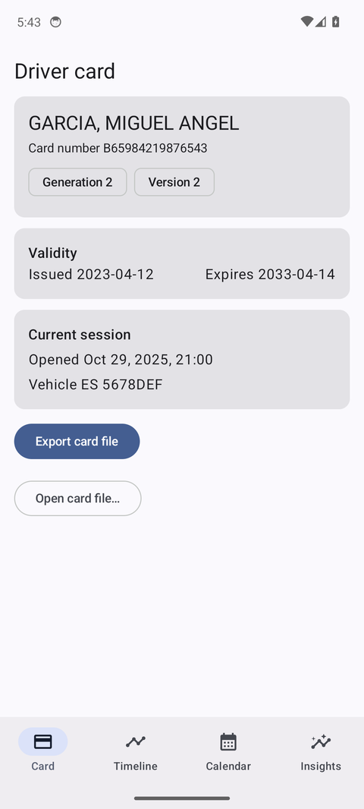
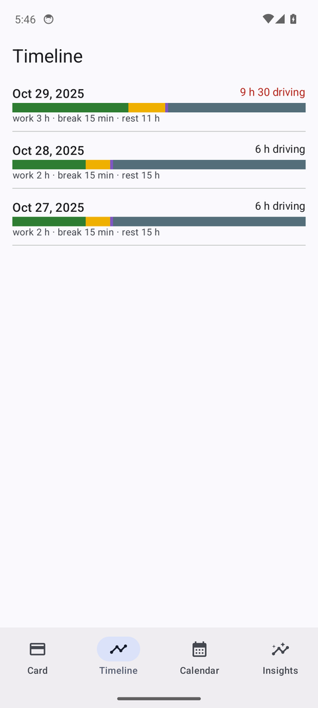
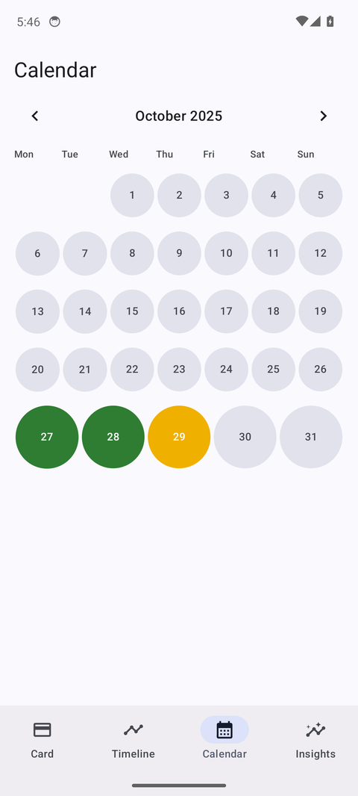
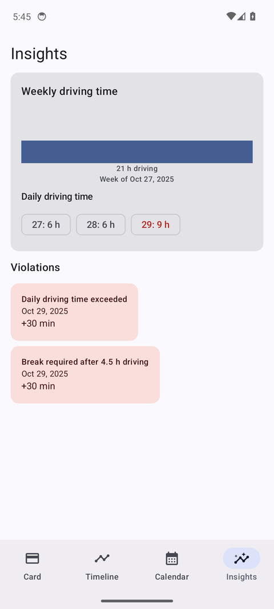

# Tacho Colega

**Read and understand your EU tachograph card — straight from your phone.**

Tacho Colega is an Android app that downloads the contents of a European
Union driver tachograph card over NFC and turns it into something a driver
can actually use: a daily timeline, a month calendar, and driving-time
insights checked against Regulation (EC) No 561/2006.

| Card | Timeline | Calendar | Insights |
|---|---|---|---|
|  |  |  |  |

- **Card** — holder, validity, current session, file export and import.
- **Timeline** — daily activity as a colour-coded 24 h bar.
- **Calendar** — month view with driving intensity per day.
- **Insights** — weekly totals and EU rule violations.

## Features

- **Full card download over NFC** — reads every elementary file of a driver
  card using the ISO 7816 command set from the tachograph specification
  (SELECT, READ BINARY, chunked with GET RESPONSE).
- **Generation 1 and Generation 2 cards** — including the amended
  (Commission Implementing Regulation (EU) 2021/1228) generation 2 layout:
  17-byte Application_Identification, border crossings, load/unload
  operations, load types and the GNSS accumulated-driving file.
- **Driving-time analysis** — daily/weekly/two-week driving limits, the
  4h30/45-minute break rule (including the 15+30 split), rest reductions.
- **Export** — card contents are saved to a portable `.tcd` container
  (FID-prefixed elementary files) that can be shared, archived, or re-imported.
- **Bilingual from day one** — English and Spanish, with a single string
  catalogue per language.
- **Material 3 UI** — dynamic colour, bottom navigation, built for use in a
  cab.

## Architecture

Two Gradle modules:

```
core/   pure-Kotlin domain: byte readers, APDU protocol, binary parsers
        (C1V1/C2V2 card blocks), EU regulation analysis. No Android deps,
        fully JVM-testable.
app/    Jetpack Compose UI, Hilt DI, NFC transport (IsoDep), Room-ready
        data layer.
```

The binary parsing follows **Regulation (EU) 2016/799** (Appendix 1B card
formats, with the 2021/1228 amendments) — generation 2 driver card
structures are the 17-byte `DriverCardApplicationIdentification`, the 18-byte
`GNSSAccumulatedDrivingRecord` and the authentication-status, border-crossing
and load/unload files introduced for version 2 cards.

## Building

```bash
./gradlew :app:assembleDebug     # debug APK
./gradlew test                   # all unit tests (core + app, Robolectric)
./gradlew :app:assembleRelease   # release APK (needs signing config)
```

Requirements: JDK 17+, Android SDK (compileSdk 37). `local.properties` points
at the SDK as usual.

## Testing

- **Core**: synthetic byte-level card dumps round-tripped through every
  parser; EU rule checks (daily/weekly limits, split breaks) as hand-built
  activity days.
- **App**: Robolectric tests for the view model and the dump container.

## License

Proprietary — © colega. All rights reserved.
